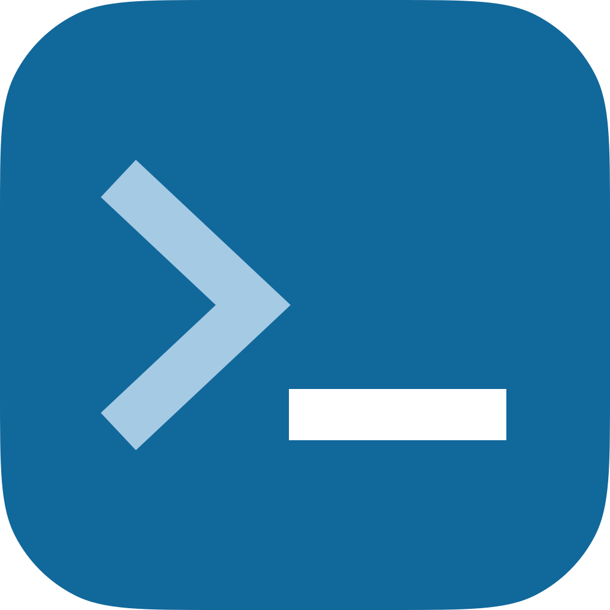

# XenForo CLI



[](https://xenforo.com)
[](https://github.com/xenforo-ltd/cli/blob/main/LICENSE)
[](https://github.com/xenforo-ltd/cli/releases)
[](https://github.com/xenforo-ltd/cli/actions)
[](https://app.codecov.io/gh/xenforo-ltd/cli)

A command-line tool for XenForo license holders to provision and manage local
development environments. It authenticates against your XenForo customer
account, downloads packages, and orchestrates Docker-based environments.

## Prerequisites

To manage environments, you must install
[Docker](https://docs.docker.com/get-docker/) with the
[Compose](https://docs.docker.com/compose/install/) plugin.

## Installation

Install the XenForo CLI using one of the methods below.

### Homebrew

```bash
brew install xenforo-ltd/tap/xf-cli
```

### WinGet

```powershell
winget install XenForo.CLI
```

### GitHub Releases

Download the latest binary archive from the
[releases page](https://github.com/xenforo-ltd/cli/releases).

## Quick start

```bash
# Authenticate
xf auth login

# Initialize a project
xf init ./my-project
```

By default, `xf init` starts the Docker environment, installs XenForo, and
prints the site URL. Open that URL in your browser.

## CLI usage

### CLI configuration

Default configuration file locations:

| Platform | Path                                                            |
| -------- | --------------------------------------------------------------- |
| macOS    | `~/Library/Application Support/xf/config.json`                  |
| Linux    | `$XDG_CONFIG_HOME/xf/config.json` or `~/.config/xf/config.json` |
| Windows  | `%AppData%\xf\config.json`                                      |

Use `--config` to select another file.

Set CLI environment variables in your shell. These are separate from the
project's `.env` file, which configures the Docker environment.

| Variable            | Description                                                       |
| ------------------- | ----------------------------------------------------------------- |
| `XF_DIR`            | Sets the XenForo installation to use when outside an installation |
| `XF_AUTH_STORAGE`   | Selects credential storage: `keychain` or `file`                  |
| `XF_TOKEN`          | Supplies an OAuth access token instead of stored credentials      |
| `XF_VERBOSE`        | Enables verbose output                                            |
| `XF_NO_INTERACTION` | Disables interactive prompts                                      |
| `XF_CACHE_PATH`     | Sets the CLI cache directory                                      |

Authentication uses the system keychain by default. To use file storage, set
`auth.storage` to `file` in `config.json`, or set `XF_AUTH_STORAGE=file`.
Credentials are then stored as plaintext in `auth.json` beside the configuration
file. Keep this file private and out of version control.

For CI, a non-empty `XF_TOKEN` overrides stored credentials. Supply an existing
OAuth access token without the `Bearer` prefix, using your CI secret settings.
The CLI cannot refresh environment tokens. Replace the secret when it expires.
Unset `XF_TOKEN` before using `auth` commands to manage stored credentials.

### Routing

If the provided command is not a built-in command, it is forwarded to XenForo.
When a Docker environment is initialized, it uses the running service or a
one-off container if the service is stopped. Otherwise, it uses local PHP.

For `php`, `php-debug`, `composer`, `compose`, `exec`, and `debug`, put the
CLI's global flags before the command name. Everything after it belongs to the
wrapped tool. For example, `xf --verbose php -v` enables CLI logging and runs
`php -v`. Use `xf help php`, not `xf php --help`, to read the CLI's wrapper
help.

Direct XenForo commands cannot be combined with global flags. Use a wrapper
instead, for example `xf --verbose debug xf-dev:import`.

### Commands

Run `xf --help` to list every command, and `xf help <command>` for full command
help. Run `xf list` from a XenForo directory to see XenForo commands.

#### Getting started

Authenticate and set up a XenForo development environment.

| Command    | Description                                      |
| ---------- | ------------------------------------------------ |
| `auth`     | Manage authentication                            |
| `download` | Download XenForo packages                        |
| `init`     | Initialize a new XenForo development environment |
| `licenses` | List your XenForo licenses                       |

#### Environment

Manage installations and worktrees. Docker operations require
[Docker with the Compose plugin](#prerequisites).

| Command    | Description                                |
| ---------- | ------------------------------------------ |
| `db`       | Open the environment's database            |
| `down`     | Stop the Docker environment                |
| `logs`     | Show container logs                        |
| `ps`       | List running containers                    |
| `reboot`   | Restart the Docker environment             |
| `up`       | Start the Docker environment               |
| `update`   | Update the Docker environment from the CLI |
| `upgrade`  | Upgrade an existing XenForo installation   |
| `worktree` | Create and manage development worktrees    |

#### Run tools

Build add-ons and run development tools.

| Command     | Description                              |
| ----------- | ---------------------------------------- |
| `build`     | Build an add-on release                  |
| `compose`   | Run a Docker Compose command             |
| `composer`  | Run Composer commands                    |
| `debug`     | Run XenForo CLI commands with Xdebug     |
| `exec`      | Execute a command in a running container |
| `php`       | Run PHP commands                         |
| `php-debug` | Run PHP with Xdebug                      |

#### Maintenance

Maintain the CLI and check its configuration.

| Command       | Description                                                |
| ------------- | ---------------------------------------------------------- |
| `cache`       | Manage cached downloads                                    |
| `completion`  | Generate the autocompletion script for the specified shell |
| `doctor`      | Check system health and dependencies                       |
| `help`        | Help about any command                                     |
| `self-update` | Update XenForo CLI to the latest version                   |
| `version`     | Print version information                                  |

#### Global flags

Available on all built-in commands:

```bash
# Path to config file
-c, --config <path>

# Disable interactive prompts
-n, --no-interaction

# Enable verbose output
-v, --verbose
```

## Environment usage

The default environment enables development features and uses predictable
credentials. Do not expose it publicly.

Configure the environment by setting variables in the `.env` file at the root of
your XenForo installation. Their values override options set in the XenForo
control panel. To customize the XenForo configuration further, create a
`src/config.override.php` file.

[Contexts](#contexts) can override variables from `.env`. To extend or override
the Compose configuration, create a `compose.override.yaml` file. Run
`xf reboot` to apply runtime changes. See
[Updating environments](#updating-environments) for image changes.

Runtime settings read by `src/config.docker.php` also accept a `_FILE` suffix
for a file path inside the container.

### Environment configuration

Settings and contexts marked <sup>[1](#updating-environments)</sup> may require
an image rebuild.

| Variable                     | Description                                                                                             |
| ---------------------------- | ------------------------------------------------------------------------------------------------------- |
| `XF_INSTANCE`                | Sets the [Compose project name](#running-multiple-environments)                                         |
| `XF_CONTEXTS`                | Sets the environment [contexts](#contexts) to use <sup>[1](#updating-environments)</sup>                |
| `XF_TITLE`                   | Sets the XenForo board title                                                                            |
| `XF_EMAIL`                   | Sets the XenForo default email address                                                                  |
| `XF_CONTACT_EMAIL`           | Sets the XenForo contact email address                                                                  |
| `XF_COOKIE_PREFIX`           | Sets the XenForo cookie prefix                                                                          |
| `XF_DB_USER`                 | Sets the database username (defaults for `mysql`, `postgres`)                                           |
| `XF_DB_PASSWORD`             | Sets the database password (defaults for `mysql`, `postgres`)                                           |
| `XF_DB_DATABASE`             | Sets the database name (defaults for `mysql`, `postgres`)                                               |
| `XF_DB_REPLICATION_USER`     | Sets the replication username (defaults for `mysql-replication`)                                        |
| `XF_DB_REPLICATION_PASSWORD` | Sets the replication password (defaults for `mysql-replication`)                                        |
| `XF_MSSQL_PASSWORD`          | Sets the SQL Server SA password (defaults for `mssql`)                                                  |
| `XF_MAIL_ENABLE`             | Enables or disables XenForo emails                                                                      |
| `XF_MAIL_HOST`               | Sets the XenForo SMTP host                                                                              |
| `XF_MAIL_PORT`               | Sets the XenForo SMTP port                                                                              |
| `XF_MAIL_USERNAME`           | Sets the XenForo SMTP username                                                                          |
| `XF_MAIL_PASSWORD`           | Sets the XenForo SMTP password                                                                          |
| `XF_MAIL_SSL`                | Enables or disables SMTP SSL/TLS                                                                        |
| `XF_XFES_SEARCH_USER`        | Sets the Elasticsearch username (defaults for `elasticsearch`)                                          |
| `XF_XFES_SEARCH_PASSWORD`    | Sets the Elasticsearch password (defaults for `elasticsearch`)                                          |
| `XF_CACHE_SESSIONS`          | Enables or disables caching XenForo user sessions                                                       |
| `XF_CACHE_PAGES`             | Enables or disables the XenForo guest page cache                                                        |
| `XF_IMAGICK_ENABLE`          | Enables or disables ImageMagick for image processing <sup>[1](#updating-environments)</sup>             |
| `XF_XFMG_FFMPEG_ENABLE`      | Enables or disables FFmpeg features in the XenForo Media Gallery <sup>[1](#updating-environments)</sup> |
| `XF_DEBUG`                   | Enables or disables XenForo debug mode                                                                  |
| `XF_DEVELOPMENT`             | Enables or disables XenForo [development mode](#development-mode)                                       |
| `XF_ADMIN_HUE_SHIFT`         | Sets the XenForo control panel hue shift                                                                |
| `XDEBUG_MODE`                | Sets the Xdebug mode (`off`, `debug`, `coverage`, ...) for the `development` context                    |

#### Contexts

Contexts are features selected by the colon-separated `XF_CONTEXTS` variable.
The default is `caddy:mysql:development:caddy-development:redis:mailpit`.

| Context             | Description                                                                                              |
| ------------------- | -------------------------------------------------------------------------------------------------------- |
| `caddy`             | Adds Caddy web server                                                                                    |
| `caddy-development` | Adds the OrbStack domain `{instance}.xf.local` for Caddy                                                 |
| `development`       | Mounts source files into the container and enables Xdebug support <sup>[1](#updating-environments)</sup> |
| `elasticsearch`     | Configures the environment for running XenForo Enhanced Search with Elasticsearch                        |
| `mailpit`           | Adds a Mailpit SMTP capture service                                                                      |
| `mssql`             | Adds a SQL Server database <sup>[1](#updating-environments)</sup>                                        |
| `mysql`             | Adds a MariaDB database <sup>[1](#updating-environments)</sup>                                           |
| `mysql-replication` | Adds a MariaDB read replica (requires the `mysql` context)                                               |
| `postgres`          | Adds a PostgreSQL database (for importing from Discourse) <sup>[1](#updating-environments)</sup>         |
| `redis`             | Adds Redis and enables XenForo caching <sup>[1](#updating-environments)</sup>                            |

#### Development mode

Set `XF_DEVELOPMENT=1` to enable development mode. It includes all add-ons in
development output, uses unminified JavaScript, and makes background job errors
visible. It also disables live payments, statistics collection, sitemap
submission, CAPTCHAs, and email confirmation, removes registration delays, and
extends admin sessions.

#### Advanced configuration

These environment variables control advanced settings and typically do not need
to be changed.

| Variable                | Description                                                                                         |
| ----------------------- | --------------------------------------------------------------------------------------------------- |
| `CADDY_VERSION`         | Sets the Caddy image version                                                                        |
| `ELASTICSEARCH_VERSION` | Sets the Elasticsearch image version                                                                |
| `MAILPIT_VERSION`       | Sets the Mailpit image version                                                                      |
| `MARIADB_VERSION`       | Sets the MariaDB image version                                                                      |
| `MSSQL_VERSION`         | Sets the SQL Server image version                                                                   |
| `PHP_BUILD_MYSQL`       | Enables mysqli and pdo_mysql (auto-set for `mysql`) <sup>[1](#updating-environments)</sup>          |
| `PHP_BUILD_PGSQL`       | Enables pgsql, pdo_pgsql, and YAML (auto-set for `postgres`) <sup>[1](#updating-environments)</sup> |
| `PHP_BUILD_REDIS`       | Enables igbinary and PhpRedis (auto-set for `redis`) <sup>[1](#updating-environments)</sup>         |
| `PHP_BUILD_SQLSRV`      | Enables sqlsrv and pdo_sqlsrv (auto-set for `mssql`) <sup>[1](#updating-environments)</sup>         |
| `PHP_VERSION`           | Sets the PHP image version <sup>[1](#updating-environments)</sup>                                   |
| `PHP_VERSION_COMPOSER`  | Sets the Composer version <sup>[1](#updating-environments)</sup>                                    |
| `PHP_VERSION_IGBINARY`  | Sets the igbinary extension version <sup>[1](#updating-environments)</sup>                          |
| `PHP_VERSION_IMAGICK`   | Sets the Imagick extension version <sup>[1](#updating-environments)</sup>                           |
| `PHP_VERSION_REDIS`     | Sets the PhpRedis extension version <sup>[1](#updating-environments)</sup>                          |
| `PHP_VERSION_SQLSRV`    | Sets the SQL Server PHP extensions version <sup>[1](#updating-environments)</sup>                   |
| `PHP_VERSION_XDEBUG`    | Sets the Xdebug extension version <sup>[1](#updating-environments)</sup>                            |
| `PHP_VERSION_YAML`      | Sets the YAML extension version <sup>[1](#updating-environments)</sup>                              |
| `POSTGRES_VERSION`      | Sets the PostgreSQL image version                                                                   |
| `REDIS_VERSION`         | Sets the Redis image version                                                                        |
| `XDEBUG_CONFIG`         | Sets the Xdebug client connection settings                                                          |
| `XF_DB_HOST`            | Sets the database host address (auto-set for `mysql`)                                               |
| `XF_DB_PORT`            | Sets the database port                                                                              |
| `XF_DB_REPLICATION`     | Enables MySQL read/write replication (auto-set for `mysql-replication`)                             |
| `XF_DB_HOST_READ`       | Sets the read replica host (auto-set for `mysql-replication`)                                       |
| `XF_CACHE_ENABLE`       | Enables XenForo caching (auto-set for `redis`)                                                      |
| `XF_CACHE_HOST`         | Sets the cache server host (auto-set for `redis`)                                                   |
| `XF_XFES_SEARCH_HOST`   | Sets the Elasticsearch host address (auto-set for `elasticsearch`)                                  |
| `XF_XFES_SEARCH_PORT`   | Sets the Elasticsearch port                                                                         |
| `XF_XFES_SEARCH_INDEX`  | Sets the Elasticsearch index name (auto-set for `elasticsearch`)                                    |

### Updating environments

Run `xf update` to refresh the shipped environment files, pull images, rebuild
local images, and update running environments. Stopped environments remain
stopped. Run `xf up` to start them.

`xf update` preserves `.env` and `.dockerignore` but overwrites other shipped
environment files. Keep customizations in override files.

### Running multiple environments

For multiple environments, set a different `XF_INSTANCE` for each one. Changing
this value selects a different Compose project and its volumes. It does not
migrate existing data.

## Security

Do not report security vulnerabilities in public issues.

See [SECURITY.md](.github/SECURITY.md) for vulnerability reporting instructions.

## Support

Run `xf doctor` to diagnose common issues. For help, ask in the
[development discussions forum](https://xenforo.com/community/forums/xenforo-development-discussions.34/).
For bug reports and feature requests, use this repository's GitHub Issues.

For support guidance, see [SUPPORT.md](.github/SUPPORT.md).

## Contributing

See [CONTRIBUTING.md](.github/CONTRIBUTING.md) for development and contribution
guidelines.

## License

Copyright (c) XenForo Ltd. All rights reserved.

This project is licensed under the MIT License. See [LICENSE](LICENSE) for
details.
